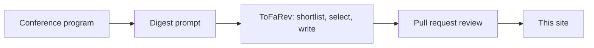

# How it works

Conference programs are long. KubeCon has more than 500 sessions, and an IETF meeting has more than 1,000 active drafts in the tracked working groups. This site keeps the few items that matter to one reader. That reader is a product manager who works on physical datacenter networking, cloud-native networking, network security, and identity.

## The pipeline

1. **Discover.** A weekly job checks each recurring conference for new editions and adds the confirmed ones to the registry.
2. **Fetch.** After an event ends, a fetcher reads its published program: papers, talks, or drafts, with abstracts and links. Some sites block cloud IP addresses. For these sites, the owner runs the fetch from a laptop.
3. **Compose.** The program goes into a prompt with the reader profile, reading guidance, and the output rules.
4. **Write.** [ToFaRev](https://github.com/hellt/tofarev) runs the prompt in GitHub Actions with `zai-org/GLM-5.3` on Nebius Token Factory. Large programs go through stages. First, batches of the program are shortlisted in parallel. Then the final picks are selected. Last, the digest is written from the selected items. ToFaRev reads the papers and slides that the picks link to, and gives their text to the writer. The writer can also fetch each pick's talk page.
5. **Check.** Code, not the model, does the last checks. It removes any link that is not in the program and flags headings that do not match a program item. It also confirms that every tier is present.
6. **Link.** Code, not the model, adds a row of links to every pick: the abstract page, the paper, the slides and the recording. They come from the program and the talk's own page. A recording found by search is added only when its title, its channel and its upload date all match the talk and the event.
7. **Review and publish.** ToFaRev opens a pull request with the digest. When it is merged, the digest appears here and the tracking issue closes.
8. **Refresh.** Recordings and slides often appear weeks after an event. Every week, for four months after each conference, the links are checked again. New ones arrive in a small pull request; the write-ups do not change.

## Reading a digest

| Tier | Meaning |
|---|---|
| **Core** | Directly about datacenter and WAN networking, cloud-native networking, network security, or identity. |
| **Adjacent** | Relevant to the broader field: useful context, or likely to matter soon. |
| **Wildcard** | Two to four items outside these interests that are novel or show where the field is going. |
| **Themes** | The patterns across the whole program. |

Each pick starts with its links: **Abstract** (the talk or paper page, which usually lists every material), **Paper**, **Slides** and **Recording**, as far as they are published. A talk recording also shows a thumbnail: click it to play the talk on the page. For IETF drafts the links are the **Draft**, its **Slides**, the **Session recording** of the working group meeting and the session **Materials**.

Each pick has the same parts. **Why** tells you why it is worth your time. **What** gives the contribution in plain terms, and **How** gives the mechanism. **Where applicable** tells you whether the work is general or specific to one organization, vendor, or deployment. A write-up marked *from abstract only* had no fuller source available. Links come from the program, so a pick without a link had none.

## Conference status

The [Conferences](conferences.md) page shows where each edition stands:

| Status | Meaning |
|---|---|
| Read the digest | The digest is published. |
| Digest in progress | The program is fetched, and a digest is being written or reviewed. |
| Waiting for the program | The event ended, but its program is not published yet. The fetch runs again each week. |
| Needs a local fetch | The site blocks cloud IP addresses, so the fetch must run from a laptop. |
| Needs a manual paste | Automatic fetch failed. Someone must paste the program in. |
| Fetcher stalled | Fetch failed four times. The site probably changed, and the fetcher needs a fix. |
| Upcoming | The event has not ended yet. |

The source, the prompts, and every digest are in [hellt/conference-digest](https://github.com/hellt/conference-digest).
