# How it works

Conference programs are long. KubeCon has more than 500 sessions, and an IETF meeting has a large agenda spread across many working groups. This site keeps the few items that matter to one reader: a product manager who works on networking, cloud platforms, Kubernetes, and AI.

## Which conferences are tracked?

The [Conferences](conferences.md) page is the live tracker. It lists every registered edition, its end date, and whether its digest is upcoming, waiting, in progress, or published. The current conference families are:

- **Network operators, Internet governance, and vendors:** APRICOT; ARIN; AusNOG; AutoCon; Capacity Europe; Cisco Live Europe and US; DENOG; DKNOG; GRNOG; ITNOG; LACNIC; MORE-IP; NANOG; Netnod Tech Meeting; NetUK; NLNOG; nog.fi; NZNOG; Open vSwitch and OVN Fall Conference; Peering Days; RIPE; SwiNOG; TNC; and ZANOG@iWeek.
- **Research, standards, and security:** ACM CCS, CoNEXT, IMC, and SIGCOMM; hack.lu; IETF; Netdev; NSDI; PETS; SREcon Americas; and USENIX Security.
- **Cloud, AI, and open infrastructure:** CfgMgmtCamp Ghent; FOSDEM; KubeCon + CloudNativeCon Europe and North America; MLSys; NVIDIA GTC; OCP Global Summit; OPI Summit on DPUs/IPUs; and PyTorch Conference.

This list mixes recurring series configured for automatic discovery with individually registered editions. The tracker is generated from the registry, so it includes upcoming editions as well as those with published digests.

## The pipeline

```mermaid
flowchart LR
  S["Series rules and edition registry"] --> D["Discover editions and fetch programs"]
  D --> P["Committed digest prompt and tracking issue"]
  P --> T["Nebius Token Factory: shortlist, select, write"]
  T --> C["Validate, add links and search tags"]
  C --> R["Digest pull request"]
  R -->|A person merges| W["Published site"]
  W --> L["Daily links refresh"]
  L --> Q["Links pull request"]
```

### 1. Discover new editions automatically

A scheduled scan runs every Monday, with a manual workflow dispatch available when needed. Discovery reads `conferences/series.yaml`, which describes each recurring conference, and `conferences/registry.yaml`, which contains the editions already tracked.

For each series, discovery:

1. Reads the latest matching registry key to work out where the series is up to. Series are enumerated by calendar year (for example, `sigcomm-{year}`) or by an ordinal (for example, `ietf-{n}` or Netdev's hexadecimal edition number).
2. Fills the series' key, name, and URL templates to construct the next candidates. Existing entries are never edited or replaced.
3. Asks the conference's fetcher to **probe** the source to confirm that the edition really exists and, where available, read its dates.
4. Runs the real **fetch** as a second gate for most sources. The edition is added only when a usable program is available, not when the site merely contains a placeholder or call for papers. IETF is the exception: its datatracker meeting API is authoritative, so its probe is sufficient.

A confirmed edition is appended to the registry with its fetcher and source URLs. Dates stated by the source win; otherwise the series can supply an estimated end date, which is marked for human confirmation. Discovery re-parses the registry after writing and rolls back an invalid result. If nothing is published yet, the candidate is simply probed again on a later scan.

Sources that block cloud runners are not probed from CI; their discovery and fetch run locally. One-off editions, or editions a series rule cannot derive, can be added to the registry by hand.

Registration does not immediately trigger writing. The normal fetch gate is **the event has ended and no `digests/<key>.md` exists**. A newly discovered past edition can continue through the same scan; an upcoming edition waits.

### 2. Fetch the program and generate the prompt

Each source has a fetcher that extracts program items with their titles, speakers or authors, abstracts when published, and material links such as `page:`, `pdf:`, `slides:`, `video:`, and `materials:`. A fetcher reports a real program, not yet published, or manual fallback; one broken source does not stop the scan. Waiting and failed editions are retried, and repeated failures eventually surface as **Fetcher stalled** rather than producing a digest from bad input.

For a successful fetch, code composes `prompts/<key>.md` from:

- a run note naming the exact digest file to produce;
- the shared template in `conferences/prompt/base.md`;
- the conference name, source URL, registry key, and date;
- the controlled search-tag vocabulary; and
- the fetched program text itself.

The prompt is the bot's job specification and source material, not just a wrapper around the program. It defines the reader's interests, the Core / Adjacent / Wildcard selection rules, and the preference for novel techniques, substantiated results, and transferable operational lessons over vendor pitches. It also requires exact program titles, a consistent Why / What / How / Where-applicable write-up, a Themes section, and search keywords. Grounding rules tell the writer to read linked papers or pages on a best-effort basis, never invent missing findings, and mark write-ups based only on an abstract.

The generated prompt is committed and becomes the input to the drafting workflow. The scan also opens or updates that edition's tracking issue. Keeping the prompt in the repository makes the run reproducible and provides the manual path: a blocked program can be pasted below the prompt's `PROGRAM TEXT` separator, and a person can run the same prompt outside the bot.

### 3. Draft with Nebius Token Factory

The drafting workflow runs after a scan, after a prompt is pushed, or on manual dispatch. Its normal queue contains committed prompts that do not yet have a digest or an open digest PR; a forced run can rewrite one conference and update its PR.

[Nebius Token Factory](https://tokenfactory.nebius.com/) is the **inference engine for all model work**, using the configured `zai-org/GLM-5.3` model. For large programs, it shortlists batches in parallel, narrows the shortlist to the final selections, and writes the digest from those items. The drafting workflow can enrich selected items from their linked papers, slides, and talk pages; enrichment deepens the write-up but does not change selection or tier.

The workflow returns the draft for automated validation and pull-request review; the model does not push to this repository. Discovering editions, fetching programs, building links rows, and publishing the site remain code and workflow steps, not model work. The same committed prompt can also be run by hand without using this bot path.

### 4. Validate the draft and build every links row

Code performs the final mechanical checks. Automated checks reduce links absent from the program text to plain text and flag pick headings that match no program item. The proposal step validates the artifact and metadata, normalizes the conference title, extracts the writer's keywords into `conferences/tags.yaml`, and builds the site before proposing the change.

For every pick, `conferences/links.py` builds a `**Links:**` row when at least one usable link exists; the model never writes the row. Slides and YouTube recordings are resolved in this order:

1. **Use the program item's own links.** Fetchers preserve the talk or paper page and any paper, slide, recording, or materials URL published in the program. A deck available in two formats keeps both, for example Slides (PDF) and Slides (PPTX).
2. **Read the talk page again.** After an event, pages often gain an embedded recording or attachments. The parser recognizes YouTube embeds and unambiguous watch links, and classifies PDF and presentation-file links from their URLs and link text. When a page blocks the runner, an approved Tavily Extract fallback can read it.
3. **Use reviewed stream offsets where configured.** A pick can link to its exact start in a whole-day recording when that offset was previously checked against the stream's transcript.
4. **Search only if the recording is still missing.** A known official conference channel is searched first, then general YouTube search, with Tavily search as a fallback when YouTube cannot be reached. A candidate is accepted only after checks against the talk title, the conference or channel, and an event-relative upload window; official-channel uploads may use a shortened title, and very short videos are rejected. An uncertain candidate gets no link.

Before a row is published, file links and videos are probed again. Confirmed dead links are dropped; an unreachable or inconclusive check does not erase a previously found link. This is deliberately a “no link rather than a wrong link” policy.

### 5. Review, publish, and refresh

The proposal job opens one `digest: <key>` pull request containing the digest and its search tags. A person reviews and merges it. The merged `digests/<key>.md` file is the only signal that an edition is done; it also closes the tracking issue and triggers site publication.

Slides and recordings often arrive after the digest. Every day, Links Refresh reruns the same deterministic link builder for digests whose events ended in the last 120 days. It rechecks talk pages, searches for missing recordings, and removes links confirmed dead. If anything changed, it opens a separate `links: <key>` PR; the write-ups are not rewritten. Older editions can be refreshed through manual workflow dispatch.

## Search

Digest and talk pages carry topic keywords when the writer's keywords block validates. The writer chooses them from a controlled vocabulary covering the reader's areas, including BGP, AI clusters, optics, Kubernetes, and cloud. The pipeline stores them as hand-editable repository metadata, and the site's search indexes them like a page title. Searching for a topic such as `ebpf` or `Kubernetes` can therefore find a relevant talk even when that word is absent from its title. Talk pages also show their tags as clickable chips; each tag opens a page listing every picked talk with that tag, grouped by conference.

## Reading a digest

| Tier | Meaning |
|---|---|
| **Core** | Directly about networking, cloud, Kubernetes, or AI. |
| **Adjacent** | Relevant to the broader field: useful context, or likely to matter soon. |
| **Wildcard** | Two to four items outside these interests that are novel or show where the field is going. |
| **Themes** | The patterns across the whole program. |

Each pick starts with its available links: **Abstract** (the talk or paper page, which usually lists every material), **Paper**, **Slides**, and **Recording**. A talk recording also shows a thumbnail: click it to play the talk on the page. For IETF drafts the links are the **Draft**, its **Slides**, the **Session recording** of the working group meeting, and the session **Materials**.

Each pick has the same parts. **Why** tells you why it is worth your time. **What** gives the contribution in plain terms, and **How** gives the mechanism. **Where applicable** tells you whether the work is general or specific to one organization, vendor, or deployment. A write-up marked *from abstract only* had no fuller source available. A missing link means none was published or verified at the last link run; a later refresh can add it.

## Conference status

The [Conferences](conferences.md) page shows where each edition stands:

| Status | Meaning |
|---|---|
| Read the digest | The digest is published. |
| Digest in progress | The program is fetched, and a digest is being written or reviewed. |
| Waiting for the program | The event ended, but its program is not published yet. The fetch runs again each week. |
| Needs a local fetch | The site blocks cloud IP addresses, so the fetch must run from a laptop. |
| Needs a manual paste | Automatic fetch failed. Someone must paste the program in. |
| Fetcher stalled | Fetch failed four times. The site probably changed, and the fetcher needs a fix. |
| Queued | The event ended, but the work item has not been fetched yet. |
| Upcoming | The event has not ended yet. |

The source, the prompts, and every digest are in [hellt/conference-digest](https://github.com/hellt/conference-digest).

## Credits

Thanks to [Michael Kashin](https://github.com/networkop) for the original [conference-digest](https://github.com/networkop/conference-digest) repository, from which this repository is forked.
